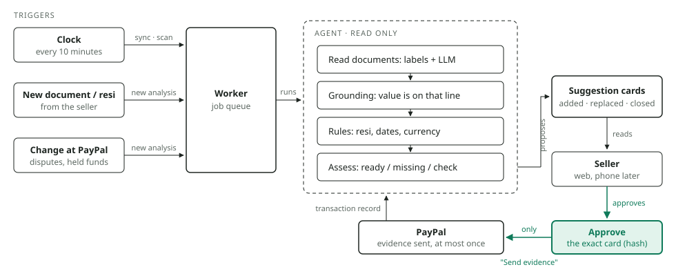

# SAL Resolve

**A deal check for PayPal sellers, anywhere in the world.** SAL compares what the buyer ordered with what the seller is
about to invoice and catches a wrong item, quantity, price or address before delivery. A dispute is cheapest to win
when it never starts, and the record SAL keeps is ready if one does. When a case does reach PayPal, SAL reads the
evidence, shows what it proves and what is missing, and drafts a reply from verified facts only. **Nothing is sent to
PayPal until the seller approves it.**

Built for the PayPal AI Hackathon (submission due 12 Nov 2026, 12:00 PT). PayPal runs in Sandbox only.

## What SAL does

| Part | What happens | Where |
|---|---|---|
| **Deal Check** | Upload a purchase order and an invoice (PDF or photo), or send them as data. SAL reads each value, the seller confirms it, and plain code compares the two. Any difference puts the deal on **hold** with the reason; a corrected invoice that matches clears it. | `/deals`, [ADR-008](docs/adr/ADR-008-deal-check.md) |
| **For AI agents** | Buyer and seller AI agents use SAL through its MCP server (`create_order`, `send_invoice`, `get_deal`) or call `/agent/v1/deals` directly, each with its own key. A buyer's key can only order and read its own deals; a seller's key can only invoice. | [ADR-008 D4](docs/adr/ADR-008-deal-check.md) |
| **Disputes and chargebacks** | The worker syncs PayPal cases, keeps a fact only when it is written on a quoted document line, and suggests the next step: send evidence, add a missing document, mind the deadline, or money on hold. | `/disputes`, [ADR-006](docs/adr/ADR-006-agent-action-proposals.md) |
| **Packing proof** | A photo or video of the parcel before shipping, linked by QR code to the order. | `/packing`, [ADR-007](docs/adr/ADR-007-packing-proof-vault.md) |
| **Seller accounts** | Sign-up, sign-in with an authenticator app (two-step), recovery codes, lockout after repeated failures. | `/signup`, `/account`, [ADR-009](docs/adr/ADR-009-accounts.md) |

Accounts are for sellers. Each account is one business, and its data is kept apart from every other business by
row-level security in PostgreSQL. Buyers take part through their own agent key or the correction message the seller
sends; they never see the seller's case or evidence.

## How the agent works



- **Runs on its own.** Every `SAL_WATCH_MINUTES` (default 10) the worker syncs PayPal disputes, scans held funds,
  finishes any deal check that did not complete and refreshes every open case's cards. A new document, a typed
  tracking number or a PayPal change starts a fresh analysis.
- **Only reads.** The model proposes values; SAL keeps one only if it is written on the line it quotes. The deal
  verdict and the dispute rules are plain code, so the same input always gives the same answer and no text inside a
  document can steer it.
- **Stops at one gate.** Only the approved **Send evidence** card writes to PayPal, at most once. A deal hold never
  calls PayPal at all.

## Honest limits

- Documents are read by OpenAI. The upload dialog says so before anything is sent.
- First test on real public documents (4 City of San Diego purchase orders, 3 Bradenton Beach invoices): PO number,
  total and tax were right on all four POs; one PO had quantity and unit price swapped, which is why the seller
  confirms every value. Long timesheet invoices were read only in part and were held, not cleared. Too few documents
  to claim an accuracy rate. Details: [ADR-008](docs/adr/ADR-008-deal-check.md).
- The agents in the demo are real model-driven agents that choose their own tool calls over MCP. The one fixed step
  is the seller's billing system sending a wrong invoice, so the mistake is the same on every run. There is no ACP
  or AP2 integration.
- Not deployed. Everything below runs on your machine.

## Layout

| Path | What |
|---|---|
| `apps/api/` | FastAPI backend and worker, PostgreSQL with forced row-level security, Alembic migrations. See its README for the permission model. |
| `apps/web/` | Next.js UI. Talks to the API on the server side only; the session lives in an httpOnly cookie. |
| `data/golden/` | Synthetic evaluation cases. Released versions are frozen and checked by `CHECKSUMS.sha256`. |
| `docs/samples/` | An invented purchase order and two invoices (one matches, one has a wrong quantity) for trying Deal Check. |
| `docs/adr/` | Architecture decision records, ADR-001 to ADR-009. |
| `spikes/paypal_sandbox/` | PayPal Sandbox Disputes API spike. |
| `contracts/paypal/` | Recorded, redacted Sandbox payloads used by the PayPal adapter's contract tests. |

## Quick start

Windows, with Docker Desktop, Python 3.12+ and Node 20+:

```
.\sal setup     # first time: venv, packages, .env, database, demo data
.\sal start     # database + API + worker + web (production build, about a minute), opens http://localhost:3000
.\sal dev       # the same, but the web reloads on every code change (pages compile on first visit)
.\sal backend   # database + API + worker only (API docs: http://127.0.0.1:8000/docs)
.\sal web       # web only (needs the backend)
.\sal stop      # stop API, worker and web
.\sal status    # what is running
.\sal seed      # add the demo data again
.\sal test      # backend tests on their own sal_test database
.\sal eval --split sea_dev --roles llm   # score the dispute agent (needs SAL_LLM_* in apps/api/.env)
```

If PowerShell blocks scripts, use `.\sal.cmd start`. Settings and keys go in `apps/api/.env` (copied from
`.env.example`); it is never committed.

To sign in to the demo business that `.\sal setup` creates, add a login to it and type the password when asked:

```
cd apps/api
python -m app.accounts add-user you@example.com
```

Or create a new business at http://localhost:3000/signup.

## Try it

| # | Do | You should see |
|---|---|---|
| 1 | Sign in, then turn on two-step sign-in under **Account** | A QR code for your authenticator app and ten recovery codes, shown once |
| 2 | **Deals → Add a document**, upload `docs/samples/1-purchase-order-PO-DEMO-1001.pdf` | The page beside the values SAL read; correct anything wrong, then save |
| 3 | On that deal, **Add invoice** with `docs/samples/3-invoice-wrong-quantity.pdf` | The deal goes on **hold** and says which quantity differs |
| 4 | **Add invoice** again with `docs/samples/2-invoice-matches.pdf` | The hold clears |
| 5 | On **/demo**, press **Run the agents** (needs `SAL_LLM_*`; or `python -m app.ai_agents` in `apps/api`) | A buyer's AI agent places an order over MCP, a wrong invoice puts the deal on hold, the seller's AI agent reads why and sends a corrected invoice, and the buyer's agent answers PAY only once SAL says CLEAR |
| 6 | Open **Disputes** | Cases with what the documents prove, what is missing, and the next step |
| 7 | `.\sal test` | All backend tests pass (PayPal and the model are faked) |

`python -m app.simulate_agents` runs the same deal with fixed scripts and no model.

### Connect your own agent

Issue a key with `python -m app.agent_identity issue <name> BUYER_AGENT` (or `SELLER_AGENT`); `list` and
`revoke <id>` manage them, and keys expire after 90 days. Then add SAL to any MCP client, for example Claude Desktop:

```json
{
  "mcpServers": {
    "sal-resolve": {
      "command": "C:/path/to/sal-project/.venv/Scripts/python.exe",
      "args": ["-m", "app.mcp_server"],
      "cwd": "C:/path/to/sal-project/apps/api",
      "env": { "SAL_AGENT_TOKEN": "salagent....", "SAL_API_URL": "http://127.0.0.1:8000" }
    }
  }
}
```

The MCP server holds no rights of its own. Every call goes to `/agent/v1/` with that key, and the API decides what
the key may do.

## Evaluation data

| Split | Cases | Use |
|---|---|---|
| `development` (v1.0.0) | 24 | Pipeline work; the only split that may be seeded into PayPal Sandbox |
| `calibration` (v1.0.0) | 8 | Kept for later threshold tuning; not used yet |
| `holdout` (v1.0.0) | 8 | Final evaluation only |
| `real_format` (v1.1.0) | 6 | Dates in words, symbols, e-mails, scans, an injected instruction |
| `sea_dev` (v1.2.0) | 18 | Indonesian and Philippine couriers, amounts and chats, address and date traps, unauthorized payments |
| `sea_holdout` (v1.2.0) | 8 | Scored only with `--final` |

Scores and what they do not prove: [docs/testing/agent-evaluation.md](docs/testing/agent-evaluation.md).

## License

MIT, see [LICENSE](LICENSE). Every case in `data/golden/` and every file in `docs/samples/` is invented; the repo holds
no real customer data.
